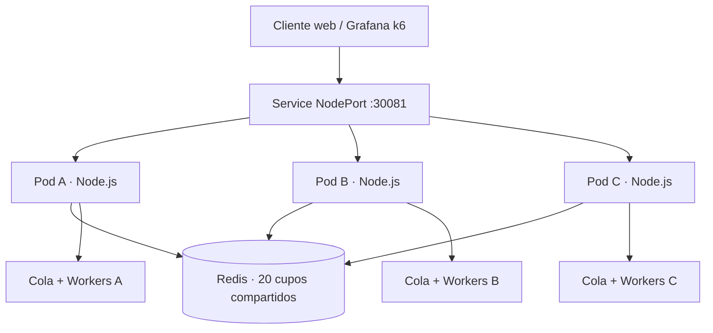

<div align="center">

# 🎟️ TicketRush

### Reservas distribuidas · Redis · Worker Threads

**20 cupos · 100 intentos concurrentes · 3 réplicas**

Node.js 22 · Redis 7 · Docker · Kubernetes · Grafana k6

</div>

TicketRush es una aplicación de reservas que permite estudiar dos problemas: cómo mantener un único estado entre varios pods y cómo ejecutar cálculos intensivos sin bloquear el hilo principal de Node.js.

Cada reserva aprobada genera un código de validación mediante **200 000 operaciones SHA-256**. El mismo cálculo puede ejecutarse en el hilo principal (`MAIN`) o en un Worker Thread (`WORKER`). Redis coordina los cupos y un pool limita los Workers activos en cada pod.

## Contenido

- [Arquitectura](#arquitectura)
- [Organización del proyecto](#organización-del-proyecto)
- [Puesta en marcha](#puesta-en-marcha)
- [API y configuración](#api-y-configuración)
- [Experimentos](#experimentos)
- [Resultados](#resultados)
- [Decisiones y límites](#decisiones-y-límites)
- [Detener el entorno](#detener-el-entorno)

## Arquitectura



Redis ejecuta un script Lua que comprueba la disponibilidad y descuenta un cupo de forma atómica. Una reserva rechazada incrementa el contador de rechazos. Cuando la reserva es aprobada, el pod ejecuta el cálculo y devuelve su código de validación junto con el hostname.

El límite de Workers es **por pod**: con tres réplicas y `MAX_WORKERS=2`, pueden existir hasta seis Workers activos en el conjunto. Cada pod mantiene su propia cola FIFO.

## Organización del proyecto

```text
ticket-rush/
├── src/
│   ├── server.js                     # API HTTP y archivos del frontend
│   ├── reservation-service.js        # Selección de estado local o Redis
│   ├── local-reservation-service.js  # Cupos en memoria protegidos por Mutex
│   ├── redis-reservation-service.js  # Coordinación atómica con Lua
│   ├── redis-client.js
│   ├── mutex.js
│   ├── cpu-task.js                   # 200 000 hashes SHA-256
│   ├── cpu-worker.js                 # Ejecución del cálculo en otro hilo
│   ├── processing-service.js         # Selección MAIN / WORKER
│   └── worker-pool.js                # Límite de concurrencia y cola
├── public/                           # Interfaz web
├── k8s/                              # Deployments y Services
├── tests/
│   ├── reservation-load.js           # 100 intentos de reserva
│   ├── ping-load.js                  # /ping y trabajo CPU simultáneos
│   ├── integrated-test.js            # Reservas + /ping + Workers
│   ├── run-ping-load.ps1             # Automatiza MAIN / WORKER
│   ├── run-worker-pool.ps1           # Automatiza límites 1, 2, 4 y 8
│   └── watch-workers.ps1             # Muestras de actividad por pod
├── results/                          # Resúmenes y registros de las pruebas
├── Dockerfile
└── package.json
```

Los archivos `.js` de `tests/` son pruebas k6. Los `.ps1` automatizan comandos de PowerShell y guardan resultados con fecha y hora.

## Puesta en marcha

Se requiere Node.js 22 o superior, Docker Desktop con Kubernetes, kubectl y k6. Ejecutar los comandos en PowerShell desde la raíz de `ticket-rush`.

### Ejecución local

```powershell
npm ci
$env:RESERVATION_MODE = 'local'
$env:CPU_MODE = 'main'
npm start
```

La interfaz y la API quedan disponibles en `http://localhost:3000`. En otra terminal:

```powershell
Invoke-RestMethod http://localhost:3000/status
Invoke-RestMethod -Method Post http://localhost:3000/reserve
Invoke-RestMethod -Method Post http://localhost:3000/reset
```

### Despliegue en Kubernetes

```powershell
docker build -t ticket-rush:v5 .
kubectl apply -f k8s/redis.yaml
kubectl apply -f k8s/deployment.yaml
kubectl apply -f k8s/service.yaml
kubectl rollout status deployment/redis --timeout=120s
kubectl rollout status deployment/ticket-rush --timeout=180s
kubectl get pods
```

Abrir **http://localhost:30081**. El manifiesto configura tres réplicas, estado en Redis, modo WORKER y dos Workers por pod. La imagen usa `imagePullPolicy: Never` y debe estar disponible en el entorno del nodo.

```powershell
Invoke-RestMethod http://localhost:30081/status
Invoke-RestMethod http://localhost:30081/workers/status
```

## API y configuración

| Método | Ruta | Uso |
| --- | --- | --- |
| GET | `/` | Interfaz de reservas |
| GET | `/ping` | Respuesta ligera para medir disponibilidad y latencia |
| GET | `/status` | Cupos disponibles, aprobaciones y rechazos |
| POST | `/reserve` | Reserva un cupo; responde 201 o 409 si está agotado |
| POST | `/reset` | Restablece 20 cupos y reinicia los contadores |
| POST | `/benchmark/cpu` | Ejecuta el cálculo sin consumir cupos |
| GET | `/workers/status` | Modo, límite, Workers activos, cola y hostname |

| Variable | Valores / función |
| --- | --- |
| `RESERVATION_MODE` | `local` o `redis` |
| `REDIS_URL` | Dirección del servicio Redis |
| `CPU_MODE` | `main` o `worker` |
| `MAX_WORKERS` | Entero positivo; límite local a cada pod |
| `PORT` | Puerto HTTP del servidor; 3000 por defecto |
| `BASE_URL` | Dirección que utiliza `ping-load.js` e `integrated-test.js`; por defecto `http://localhost:30081` |

## Experimentos

### 1. Reservas: Mutex local y Redis

`reservation-load.js` configura 100 VUs y una iteración por VU: **100 intentos de reserva**. Con un único estado de 20 cupos, se esperan 20 aprobaciones, 80 rechazos y cero disponibles.

Para seleccionar el escenario local, establecer `RESERVATION_MODE=local` y probar primero una réplica y después tres. Cada proceso tiene su propia memoria y su propio Mutex; con tres pods pueden aprobarse más de 20 reservas en total porque no comparten el estado.

Para el escenario distribuido con Redis:

```powershell
kubectl set env deployment/ticket-rush RESERVATION_MODE=redis CPU_MODE=worker MAX_WORKERS=2
kubectl scale deployment/ticket-rush --replicas=3
kubectl rollout status deployment/ticket-rush --timeout=180s
Invoke-RestMethod -Method Post http://localhost:30081/reset
$stamp = Get-Date -Format 'yyyyMMdd-HHmmss'
New-Item -ItemType Directory -Path results -Force | Out-Null
k6 run --summary-export="results/reservations-$stamp.json" --console-output="results/reservations-$stamp.txt" tests/reservation-load.js
Invoke-RestMethod http://localhost:30081/status
```

Antes de iniciar una prueba, esperar a que terminen los pods del escenario anterior. En modo local, `/reset` afecta únicamente al pod que recibe la solicitud; para una prueba distribuida local se debe asegurar el estado inicial de cada réplica.

### 2. MAIN frente a WORKER

```powershell
.\tests\run-ping-load.ps1 -Mode main
.\tests\run-ping-load.ps1 -Mode worker
```

El script mantiene tres réplicas y fija `MAX_WORKERS=2`. Espera la salida de los pods anteriores y comprueba el modo antes de iniciar k6. La prueba verifica `/benchmark/cpu` antes de medir, para evitar comparar corridas donde el cálculo no se ejecutó correctamente.

Ambos modos reciben la misma carga: 20 VUs consultando `/ping` durante 30 segundos, con pausa de 0.25 s, y tres tareas CPU programadas por segundo. El trabajo CPU es idéntico en ambos modos.

### 3. Límites de Workers

```powershell
.\tests\run-worker-pool.ps1
```

Ejecuta tres repeticiones de la misma carga con límites de **1, 2, 4 y 8 Workers por pod** y guarda los resultados en `results/worker-pool-FECHA-HORA/`. Solo debe variar el límite. No ejecutar otras pruebas de carga simultáneamente.

Para observar cada pod durante una corrida, abrir otra terminal antes de iniciar la carga:

```powershell
.\tests\watch-workers.ps1 -Seconds 90
```

El monitor consulta directamente `/workers/status` dentro de cada pod y guarda muestras con fecha, hostname, límite, Workers activos y tareas en cola en `results/workers-live-FECHA-HORA.jsonl`.

Una consulta después de la carga con cero activos no demuestra el límite bajo trabajo. La evidencia debe mostrar actividad durante la prueba; una cola en cero solo indica que no se observó espera en ese muestreo.

### 4. Prueba integrada

Con Redis y tres réplicas, configurar el límite elegido y reiniciar los cupos. El ejemplo usa dos Workers por pod, como en la corrida integrada guardada:

```powershell
kubectl set env deployment/ticket-rush RESERVATION_MODE=redis CPU_MODE=worker MAX_WORKERS=2
kubectl rollout status deployment/ticket-rush --timeout=180s
Invoke-RestMethod -Method Post http://localhost:30081/reset
Invoke-RestMethod http://localhost:30081/status
$runDir = 'results/integrated-' + (Get-Date -Format 'yyyyMMdd-HHmmss')
New-Item -ItemType Directory -Path $runDir -Force | Out-Null
k6 run --summary-export="$runDir/summary.json" --console-output="$runDir/pods.txt" tests/integrated-test.js
kubectl exec deployment/redis -- redis-cli MGET ticket-rush:available ticket-rush:approved ticket-rush:rejected
```

Esta prueba combina 100 intentos de reserva con 20 VUs consultando `/ping` durante 30 segundos. Verifica el estado inicial y final, 20 aprobaciones, 80 rechazos y 20 respuestas de procesamiento WORKER. Los HTTP 409 por cupos agotados son respuestas esperadas.

## Resultados

### MAIN frente a WORKER: corridas corregidas

| Modo | Solicitudes/s totales | Promedio /ping | p95 /ping | Máximo /ping | Errores HTTP | Errores CPU |
| --- | ---: | ---: | ---: | ---: | ---: | ---: |
| MAIN | 64.29 | 69.12 ms | 300.83 ms | 423.21 ms | 0 % | 0 % |
| WORKER, límite 2 | 80.53 | 2.12 ms | 4.10 ms | 38.50 ms | 0 % | 0 % |

Fuentes: [MAIN corregido](results/main-results-20261022-133118-701.json) y [WORKER corregido](results/worker-results-20261022-133304-037.json). Las solicitudes/s incluyen ambos endpoints; las latencias de la tabla corresponden únicamente a `/ping`.

En estas ejecuciones, sacar el cálculo del hilo principal redujo el p95 de `/ping` aproximadamente un **98.6 %** y permitió atender más solicitudes por segundo. Ambos modos completaron 90 llamadas CPU durante la carga, sin errores. La consulta CPU inicial de validación se realiza antes de la medición de los escenarios.

Se eliminaron las primeras corridas con errores CPU y la corrida que falló en la comprobación inicial del modo. La comparación utiliza los archivos corregidos enlazados arriba.

### Comparación de límites por pod

Se realizaron tres repeticiones por límite, con la misma carga y tres pods. La tabla muestra la media aritmética de cada métrica entre las tres corridas. El promedio de los p95 no es el p95 de todas las solicitudes combinadas; el promedio de los máximos tampoco es el máximo absoluto.

| Workers/pod | p95 CPU medio | Máximo CPU medio | p95 ping medio | Ping/s medio | CPU/s medio | Omitidas (total) | Tiempo real medio |
| --- | ---: | ---: | ---: | ---: | ---: | ---: | ---: |
| 1 | 774.00 ms | 971.58 ms | 3.86 ms | 77.31 | 2.95 | 0 | 32.02 s |
| 2 | 933.33 ms | 1138.50 ms | 4.09 ms | 77.33 | 2.93 | 0 | 31.23 s |
| 4 | 907.08 ms | 1632.13 ms | 4.09 ms | 77.11 | 2.93 | 1 | 31.31 s |
| 8 | 1406.29 ms | 2046.04 ms | 4.50 ms | 77.20 | 2.93 | 2 | 31.26 s |

Fuente: [comparación de las doce corridas](results/worker-pool-20261022-134149-254/comparison.csv). Todas finalizaron con código cero y sin errores CPU. El tiempo real se midió alrededor del proceso k6, incluida su validación inicial; no incluye el rollout.

**Se selecciona un Worker por pod para la siguiente prueba integrada.** En estas mediciones obtuvo el menor promedio de p95 CPU, de máximos CPU y de p95 de `/ping`, sin iteraciones omitidas. Dos Workers tampoco omitieron iteraciones, pero no mejoraron esas latencias. Cuatro y ocho no aportaron una mejora consistente; ocho tuvo la peor latencia CPU media y dos iteraciones omitidas.

El tiempo real medio varió aproximadamente entre 31 y 32 segundos. La tasa de `/ping` está condicionada por los VUs y la pausa, y la de CPU por las tres llegadas programadas por segundo; tasas similares no demuestran igual rendimiento. Esta selección se limita al equipo y la carga evaluados y no permite atribuir la causa a CPU o memoria sin mediciones de recursos.

La comparación antigua de una corrida por límite se conserva como antecedente y queda reemplazada por esta matriz repetida para la decisión. La integrada guardada utilizó dos Workers por pod: sigue respaldando sus resultados funcionales, pero falta repetirla con el límite seleccionado de uno y registrar actividad por pod.

### Prueba integrada guardada

| Indicador | Resultado |
| --- | ---: |
| Reservas aprobadas | 20 |
| Reservas rechazadas | 80 |
| Respuestas inesperadas | 0 |
| Tareas completadas en WORKER | 20 |
| Errores HTTP | 0 % |
| Checks satisfactorios | 100 % |
| Promedio de `/ping` | 3.57 ms |
| p95 de `/ping` | 5.64 ms |
| Máximo de `/ping` | 151.82 ms |

Fuentes: [resumen integrado](results/integrated-20261022-131639/summary.json) y [registro por solicitud](results/integrated-20261022-131639/pods.txt). La consulta a Redis realizada después de esta ejecución devolvió **0 disponibles, 20 aprobadas y 80 rechazadas**.

La igualdad `aprobadas + disponibles = 20`, los rechazos y los resultados WORKER respaldan la regla de negocio. Para acreditar el máximo de Workers observado y la cola, se necesitan las muestras del monitor durante la carga; los archivos de estado en reposo no sustituyen esa evidencia.

## Decisiones y límites

| Decisión | Qué resuelve | Alcance |
| --- | --- | --- |
| Mutex local | Serializa la sección crítica de un proceso | No coordina la memoria de otros pods |
| Redis + Lua | Comprueba y descuenta cupos de forma atómica | Redis es una dependencia compartida; este despliegue tiene una sola réplica |
| Worker Threads | Separa el cálculo CPU del hilo HTTP principal | No coordina las reservas entre pods |
| Cola y límite por pod | Evita crear Workers activos sin límite | La cola no tiene un máximo ni persistencia |

El pool crea un Worker por tarea cuando hay capacidad y libera el espacio al terminar el hilo. No reutiliza hilos entre tareas. Una caída del pod pierde sus tareas en memoria.

El descuento de cupo y el cálculo CPU son pasos separados: una reserva puede quedar contabilizada en Redis aunque falle el procesamiento o se pierda la respuesta al cliente. El sistema actual no implementa idempotencia. Para evitar que un reintento consuma otro cupo, una mejora sería recibir una clave de idempotencia y guardar atómicamente en Redis la operación y su resultado, devolviendo el resultado previo cuando se repita la clave.

Redis mantiene consistencia de cupos, mientras que Workers mantienen el hilo principal disponible para otras solicitudes. Son soluciones a problemas distintos. Además, tres pods en Docker Desktop comparten CPU y memoria del mismo equipo; sus resultados no equivalen a tres servidores físicos.

## Detener el entorno

Para detener únicamente TicketRush y Redis en el namespace actual:

```powershell
kubectl scale deployment ticket-rush redis --replicas=0
kubectl get pods
```

Los resultados de las pruebas permanecen en `results/`. El despliegue Redis del proyecto no tiene un volumen persistente: reemplazar su pod puede perder el estado almacenado.

## Mediciones adicionales y análisis

La nueva versión de `ping-load.js` separa `cpu_duration` de `ping_duration`. La duración CPU incluye espera en cola, creación del hilo, cálculo y respuesta; no equivale al tiempo puro de cálculo. La tasa de `/ping` está condicionada por sus 20 VUs y su pausa de 0.25 s, por lo que acercarse a 80 solicitudes/s no identifica por sí solo el mejor límite.

`run-worker-pool.ps1` ahora hace tres repeticiones por límite, espera la terminación de los pods anteriores y guarda el tiempo real de cada proceso k6 (`wallSeconds`) en archivos `-meta.json`. Este tiempo incluye validación inicial y finalización; excluye el rollout. También genera `comparison.csv`, con tasas y latencias separadas, errores y carga omitida. Los resultados históricos no se modifican: falta ejecutar la nueva matriz para obtener estas columnas medidas.

Para registrar evidencia durante la integrada, iniciar primero en otra terminal:

```powershell
.\tests\watch-workers.ps1 -Seconds 90 -OutputFile results/integrated-workers-live.jsonl
```

Ejecutar la prueba integrada mientras el monitor está activo. Después resumir las muestras:

```powershell
node tests/verify-worker-samples.cjs results/integrated-workers-live.jsonl
```

El resumen identifica cada pod, su máximo observado de Workers activos, cola y excesos del límite. Un código de salida distinto de cero indica muestras incompletas, errores, exceso o ausencia de actividad en algún pod; no equivale automáticamente a un defecto del pool. El muestreo puede perder picos entre consultas. Guardar una ruta distinta en cada corrida.

### Respuestas de análisis

1. **Mutex y tres pods.** Cada proceso tiene memoria, estado y Mutex propios. El Mutex local no sincroniza otro proceso; por ello tres estados de 20 cupos pueden superar globalmente la capacidad del evento.
2. **Consistencia con Redis.** La evidencia es el conteo conjunto: 20 aprobaciones, 80 rechazos, cero disponibles y ausencia de cupos negativos ante 100 intentos repartidos entre pods. HTTP 200/201 por sí solo no prueba la regla de negocio. El script Lua hace atómicos la comprobación, el descuento y el conteo; la lectura posterior usada para construir la respuesta puede reflejar otras reservas ya procesadas.
3. **Workers y Redis.** Workers separan trabajo CPU del hilo principal, pero no comparten automáticamente cupos entre pods. Redis coordina cupos, pero no evita que un cálculo síncrono bloquee el hilo HTTP de Node.js.
4. **Elección de límite.** Se selecciona un Worker por pod a partir de las tres repeticiones por configuración: p95 CPU medio de 774.00 ms, máximo CPU medio de 971.58 ms y p95 ping medio de 3.86 ms, sin iteraciones omitidas. Ocho Workers empeoró la latencia CPU y omitió dos iteraciones. La tabla anterior incluye tasas y tiempo medido. La integrada guardada con límite dos no equivale a validar esta nueva selección; debe repetirse con uno.
5. **Reintentos.** Actualmente una solicitud repetida puede consumir un segundo cupo. Se propone una clave de idempotencia y un registro atómico en Redis que permita recuperar la reserva original, con estados de procesamiento y una política de recuperación si falla el Worker. Un `SET NX` aislado no basta: la identificación, el descuento y el registro deben coordinarse sin dejar una reserva incompleta irrecuperable. Esta mejora es una propuesta, no una funcionalidad implementada.


